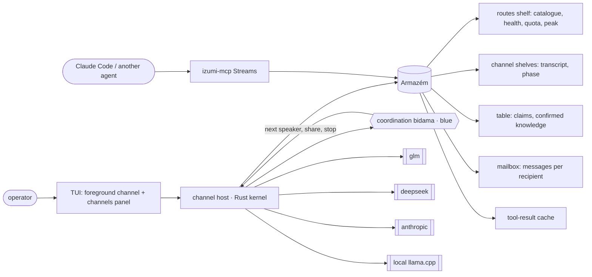
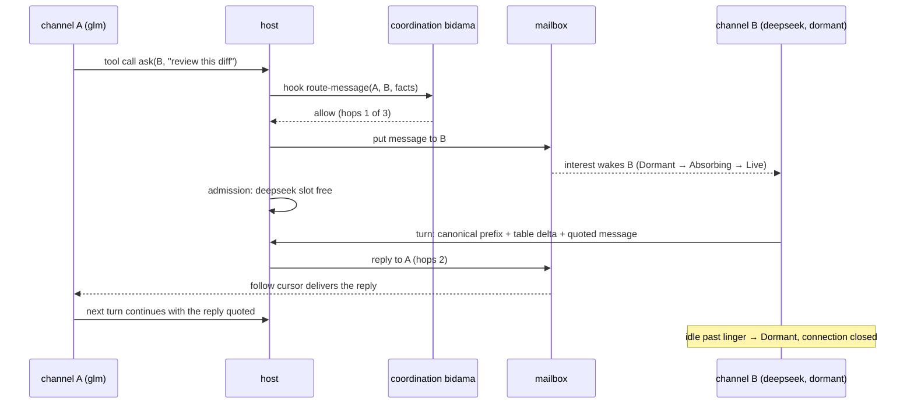
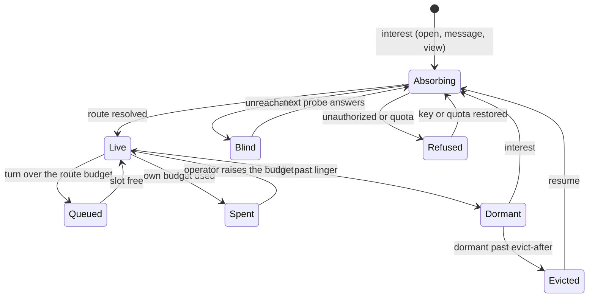

# Channels: many models at once, lazily connected, coordinated in blue

**Tier: DESIGN** (2026-11-06). Nothing here exists as code yet. The ledger at
the end states the evidence for each piece.

Operator, 2026-11-06: *arnes should be like banken with lazy connections and
data gathering, so that we can support many models at the same time and their
deep organization and coordination. I should be able to have several
background context channels, each talking to a model, make them speak with
each other, and share cache data and knowledge.*

## 1. Destination

arnes hosts **channels**. A channel is one conversation bound to one route
(a provider and a model), with its own context, its own budget and its own
transcript. Many channels run at once: one in the foreground, the rest in the
background. Every connection is **lazy**, the way banken reads a cluster:
a route, a channel or a knowledge shelf opens on interest, parks after it is
idle (its state kept on disk, its connection closed), resumes from where it
parked, and is evicted when it is old. The read side is izumi's Armazém, the
one banken already reads through, not a copy of it. The Armazém is a cached,
followed **view** and holds memory only: writes go to durable logs that arnes
owns (a channel's transcript, the table, the mailbox), and each log is the
`Source` its shelf follows.

Channels coordinate through two shared shelves. **The table** holds
knowledge: notes, findings and artifacts, each one signed by the channel that
wrote it. **The mailbox** holds messages from one channel to another. A
channel reads both by a follow cursor, so each turn sees only what changed
since its last turn. Who talks to whom, when a conversation between models
stops, and what is worth sharing is **policy, and policy is blue**: a bidama
over a small set of host words, the way `wariate` owns route choice today.
The Rust kernel only runs the turns, holds the connections and the keys, and
keeps the shelves.

### World facts that bound it

| Fact | Consequence |
|---|---|
| A prompt cache belongs to one provider, one model and one exact prefix (Anthropic per workspace with a TTL; DeepSeek per account in prefix units; Z.ai's scope is not documented) | Two different models can never share a KV cache. "Shared cache" means two things only: channels on the **same route** send a byte-identical prefix, so the provider caches it once; and **arnes's own caches** (tool results, gathered data) are shared across every channel |
| A provider limits concurrent requests (GLM's Max plan: "2 or more projects", dynamic, 429 when exceeded; llama-server has `--parallel` slots) | Each route has an admission budget. A channel over the budget waits in a typed `Queued` state. Today `AnthropicClient` retries 429 itself and fails over to fallbacks (`arnes-anthropic/src/lib.rs:123`), below any admission layer. So a channel's client gets no fallbacks and no 429 retries: admission owns both, and a channel stays on its route |
| Anthropic caches only with `cache_control`, above a minimum prefix length and within a short TTL; arnes sends no `cache_control` today (`docs/token-efficiency.md` A-table) | prefix sharing on Anthropic needs `cache_control` first (C4 prerequisite) |
| Anthropic's signed thinking blocks are valid only on the route that signed them | A message between channels carries text, never thinking blocks (`drops_foreign_thinking` already applies this to a route switch) |
| A model's claim is evidence about that model | A table entry carries its author, route and turn. A claim becomes a fact only when the operator or a declared check promotes it |

## 2. Ground: what exists

| Piece | Where | State |
|---|---|---|
| Lazy, journaled, demand-driven store: `Armazem<S: Source>`, `Shelf`, `Interesse`, phases `Absorbing → Live → Dormant`, resume tokens, typed `Gap`, the `zelador.tlisp` vigy policy | `izumi-armazem` | released; banken's views read through it (A1–A4, `banken/docs/ARMAZEM.md`) |
| Paged, budgeted MCP reads with `next` and `follow` cursors | `izumi-mcp` `Streams` | released; banken serves it |
| Routes as data: providers (`local`, `deepseek`, `anthropic`, `glm`, `messages`), fallbacks, facts, per-route health and served route | `arnes-config`, `arnes-anthropic` | shipped |
| Per-turn route choice in blue | `wariate` (`choose-route`, `@label`, `/route`) | shipped |
| One conversation, one turn task, channel-driven turn events | `arnes/src/main.rs`, `arnes-loop::run_turn` | shipped, single conversation only |
| Session transcripts and the usage ledger (per route, per provider peak hours) | `arnes-store`, `arnes-loop/ledger.rs` | shipped |
| Vigies on the shared runtime | `arnes-vigy` | shipped |

**Not found** (`rg -i "subagent|channel|multi-agent"` over arnes and the
pleme-io `theory/` and `docs/`, then a `codesearch search_repos` over 1,232
repositories): no multi-conversation host and no agent-to-agent bus exists in
the fleet. The nearest shape is the Armazém, and this design adopts it.

## 3. Research

| Prior art | Adopt / adapt / skip | Why |
|---|---|---|
| banken + izumi Armazém (lazy absorb, park, resume, evict, journaled shelves) | **adopt** | the operator named it; same lifecycle, same crate |
| izumi-mcp `Streams` (paged cursors) | **adopt** | lets Claude Code or another arnes read channels and the table without overflow |
| Claude Code subagents (a fresh context per task, a summary back) | **adapt** | a subagent is a channel with a parent, a task and one reply; ours persists and can be resumed |
| Agent-to-agent protocols (Google A2A: agent cards, tasks, messages) | **adapt** | the agent card maps to route facts (`describe`, `tier`); a task maps to a mailbox message with a reply-to. No HTTP server: channels are in-process |
| Group chat orchestration (AutoGen style: a manager picks the next speaker) | **adapt** | the next-speaker choice is a blue policy hook, beside `choose-route` |
| Provider prompt caching (Anthropic `cache_control`, DeepSeek prefix units, Z.ai automatic) | **adopt the constraint** | one canonical prefix per route, with the table delta after it, keeps every channel's cache warm |
| Shared vector memory / RAG stores | **skip for now** | the table is text with provenance and cursors. Retrieval ranking can be a later bidama over the same shelf |

## 4. States and trust

### Channel

| State | Meaning |
|---|---|
| `Absorbing` | opening: its route resolves (key, catalogue, health) and its transcript loads |
| `Live · idle` | connected, nothing running |
| `Live · turn` | a turn is running (streaming, tool call). It holds an `Interesse`, so the zelador cannot park it mid-turn |
| `Awaiting approval` | a tool call waits for the operator. The admission slot is released |
| `Queued` | a turn waits for its route's admission budget |
| `Dormant` | parked: no connection, transcript and follow cursors on disk |
| `Blind` | the route could not be reached. This is not `empty`, and the channel says so. It is probed again with backoff |
| `Refused` | the route answered `unauthorized` or the quota is exhausted. The reason is kept, and the channel stays refused until the operator or a key change acts. It is never restarted by the zelador's tick |
| `Spent` | the channel's own token, cost or turn budget is used up. Only the operator raises it |
| `Evicted` | dormant past `evict-after`. It is on disk only and resumes as `Absorbing` |

izumi's `Phase` is a closed enum (`Absorbing`, `Live`, `Degraded`, `Dormant`,
`Direct`; `izumi-armazem/src/shelf.rs:23`). The channel machine is an arnes
type beside the shelf, and the shelf phase is one input to it. Channel
transcripts get their own retention class: the session sweep (newest 200, 90
days) must never delete a dormant channel's transcript.

### Message (mailbox)

`Queued → Delivered → Consumed`, or `Expired` (TTL), or `Refused` (hop limit,
unknown recipient, recipient `Spent`), or `Lost` (trimmed before delivery).
Each message has an id, so it is a keyed record that `Consumed` removes. An
unkeyed record would sit in a bounded ring, where a trimmed message is in no
snapshot and its loss is silent.

Runaway is bounded on the causal chain, not per message. Every message and
every turn it starts carries its **root** and its **depth**. A message sent
from a message-started turn inherits depth + 1, so a fresh `ask` after a
reply does not reset it. Past `channels.max-depth` it is refused by name.
Fan-out is bounded by `channels.max-fanout` per turn. Tokens and cost are
budgeted per root tree, shared by every channel in it, so a tree of channels
is `Spent` as a whole.

### Table entry

`Claim` (written by a channel: author, route, turn, fingerprint) →
`Confirmed` (promoted by the operator or by a declared check) or `Retracted`.
An unconfirmed claim is shown as a claim.

### Trust

- Only the operator, or a policy the operator configured, opens a paid
  channel (`allow_paid`, the same knob `wariate` reads).
- A channel cannot grant itself tools. The permission gate is per channel,
  and a bidama may veto but never grant (`arnes-loop`). Today one
  `GatedDispatcher` with one approver serves everything
  (`arnes-loop/src/permission.rs`); a turn that a message started runs under a
  read-only policy unless the operator raises that channel.
- Another model's words never enter a system prompt or a user turn. The
  canonical prefix holds only `Confirmed` table entries. Claims and messages
  arrive as the result of a read tool call (`mailbox_read`, `table_follow`),
  attributed to their author and route.
- Keys stay in Rust. Blue sees route labels and facts, never a key.

## 5. Diagrams

### Context

### One channel asks another

### Channel lifecycle

## 6. Decisions

| Decision | Alternative rejected | Why |
|---|---|---|
| Reads go through `izumi-armazem`; writes go to durable logs that are its `Source`s | an arnes-local channel store; or writing into the Armazém | the lifecycle already exists in banken. The Armazém has no write path and keeps nothing on disk (`Interesse` offers `snapshot` and `since`; evict drops the shelf), so it is the view, not the record |
| Coordination is a blue bidama with host words (`arnes_channel_open`, `arnes_channel_send`, `arnes_table_put`, `arnes_table_follow`, `arnes_mailbox_follow`) | coordination in Rust | it is policy. The kernel ratchet allows host words, not policy |
| The next-speaker choice is a policy event beside `choose-route` | a fixed round-robin | the operator wants deep coordination, and that is a judgment, so it is blue and replaceable |
| Same-route channels send one canonical prefix (system prompt, tools, `Confirmed` table entries at an epoch with a stated cadence); claims and messages come after it as tool results | per-channel prefixes | cross-model KV sharing is impossible (world fact). Byte-identical prefixes are the only cache that channels can share. Each epoch rewrites every channel's cache, so epochs are rare |
| Pure read tools (Read, Grep, Glob, MCP tools declared read-only) go through one shared result cache, keyed by tool, arguments and an input fingerprint (file mtime and size) | no tool cache | two channels reading the same tree is the common case. A file write invalidates its keys |
| A channel's messages are tool results, attributed | messages as user turns, or quoting by prompt habit | a model must not be able to instruct another as if it were the operator, and a type holds that where a habit does not |
| The usage ledger gains a channel and a root dimension | budgets from the session totals | `Spent` and the per-tree budget need something to measure (`arnes-loop/src/ledger.rs`) |
| The table and the mailbox are served over `izumi-mcp` | a bespoke socket | one paging and cursor contract across the fleet |

## 7. Open questions

| Question | Kind |
|---|---|
| Z.ai's prompt-cache scope and whether `cache_read_input_tokens` is reported | world fact: probe with two same-prefix calls and read the usage |
| GLM's concurrency ceiling on the Max plan | world fact: dynamic. Admission starts at 2 and reads 429 as a signal |
| Whether the Z.ai coding-plan terms allow several concurrent arnes channels on one key | world fact: the terms say supported tools for one person. Settle it before C2 ships GLM channels by default |
| Names for the coordination bidama, the table and the mailbox | ours: the `naming` sweep, then `bidamas/NAMES.md` rows |
| Does a channel's transcript reuse `arnes-store` sessions as they are | ours: likely yes, one session file per channel |
| Should `izumi-armazem` grow an append-only signed record kind for the table, or does a keyed shelf with an author field suffice | ours: decide in C3 |
| Extend izumi's `Phase` or keep the channel machine beside it | ours: decide in C2. Beside it is the default |
| Should the zelador's restart rule learn a refused state upstream in izumi (it restarts a failed key every tick today) | ours: fix it in izumi, so banken gains it too |

## 8. Phases

Each phase ends green and moves the ledger. The coordination policy is blue;
the zelador stays the tatara-lisp program izumi ships. Each phase raises the
kernel rows it needs in `kernel-baseline.txt` with a `docs/kernel.md` §1 row in
the same commit: C1 `arnes` (the routes `Source`), C2 `arnes` and
`arnes-anthropic` (channel host, admission, a client without fallbacks or 429
retries) and `arnes-loop` (the channel ledger dimension, per-channel gates),
C3 `host: arnes-blue` (five host words) and `arnes-store` (the table and
mailbox logs), C4 `arnes-anthropic` (`cache_control`).

| Phase | Builds | Done means |
|---|---|---|
| **C1 routes shelf** | the route facts (catalogue, health, quota, peak, admission) as an Armazém `Source`, opened on interest and parked when idle. `wariate` and `/model` read it | no route is contacted at start unless it is the primary; a test shows a fallback's catalogue fetched only on first interest and parked after linger |
| **C2 channels** | `Channel` as a shelf key; N turn tasks; per-route admission; `Queued`, `Dormant`, `Blind`, `Refused`, `Spent`; one session file per channel; a channels panel on the shared navigation; `/channel new|switch|close` in `meirei` | two channels on different routes run turns at once in an offscreen test; a dormant channel resumes with its transcript; the route budget holds under a burst |
| **C3 table and mailbox** | both shelves, the follow-cursor delta in each turn, the hop limit, the coordination bidama and its `route-message` and `next-speaker` events | a scripted exchange between two mock routes ends at `max-hops` with a named refusal; a claim from A shows in B's next turn as attributed text |
| **C4 shared caches** | `cache_control` on Anthropic routes first, then the canonical prefix per route and the read-tool result cache | a recorded run of two same-route channels shows one cache write and hits after it; a file write invalidates its cached reads |
| **C5 outside readers** | `izumi-mcp` Streams over channels, table and mailbox; `arnes --mcp-socket` | Claude Code pages a channel's transcript and follows the table |

## 9. Ledger

| Piece | Design | Exists | Tested | Live |
|---|---|---|---|---|
| Armazém store and zelador | ✅ | ✅ (izumi) | ✅ (izumi, banken) | ✅ (banken) |
| routes as data, GLM among them | ✅ | ✅ | ✅ | ✅ (2026-11-06, one GLM turn) |
| routes shelf (C1) | ✅ | ❌ | ❌ | ❌ |
| channels (C2) | ✅ | ❌ | ❌ | ❌ |
| table and mailbox (C3) | ✅ | ❌ | ❌ | ❌ |
| shared caches (C4) | ✅ | ❌ | ❌ | ❌ |
| outside readers (C5) | ✅ | ❌ | ❌ | ❌ |
